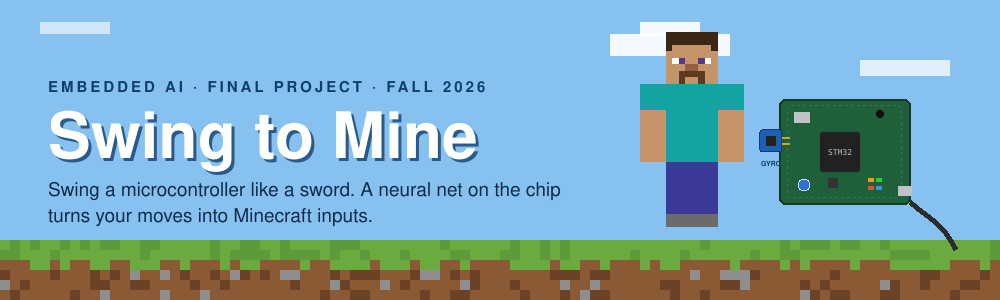
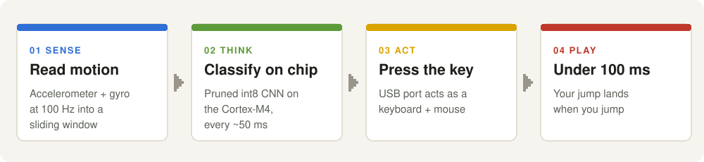
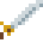
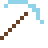
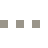
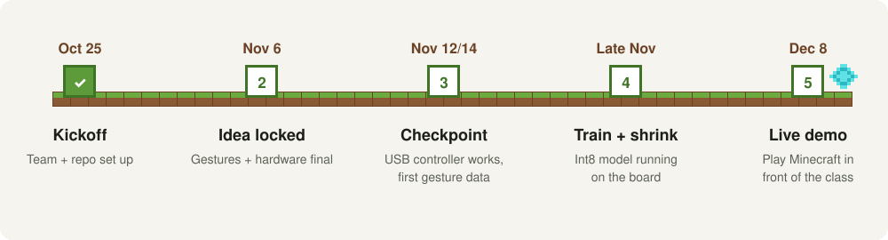

<p align="center">
  
</p>

<p align="center">
  
  
  
  
</p>

**Swing to Mine** is a motion controller for Minecraft. You hold an STM32F4 Discovery board like a sword or pickaxe, and a small int8 neural network running **on the microcontroller itself** turns your moves into real key presses and mouse clicks. The board plugs in over USB and shows up as an ordinary keyboard and mouse, so nothing needs to be installed on the PC.

> Embedded AI final project, CU Boulder, Fall 2026. One-page pitch: [docs/pitch.pdf](docs/pitch.pdf)

---

## ⛏️ How it works

<p align="center">
  
</p>

1. **Sense:** an MPU-6050 gyro + accelerometer is sampled at 100 Hz into a sliding window.
2. **Think:** a pruned, int8-quantized CNN (exported with ExecuTorch) classifies the latest window every ~50 ms on the Cortex-M4.
3. **Act:** the USB OTG port runs as a composite HID keyboard + mouse and sends the matching input.
4. **Play:** the target is under 100 ms from motion to input, so a jump lands when you jump.

## 🗡️ The moves

| | Move | Motion | Input sent |
|:-:|---|---|---|
|  | **Swing sword** | One sharp slash | Left click |
|  | **Mine** | Keep chopping | Hold left click |
|  | **Place block** | Punch forward | Right click |
|  | **Jump** | Hop, or flick up | `Space` |
|  | **Swap item** | Twist your wrist left / right | Scroll wheel |
|  | **Idle** | Anything else | Nothing |
|  | **Look / move** | Rotate the board to look; tilt to walk in move mode | Mouse movement / `WASD` |

No keyboard or mouse: the board does everything, including looking around (gyro "air mouse") and walking. See [docs/gesture-notes.md](docs/gesture-notes.md) for the control scheme. Telling **sword** apart from **mining** is the interesting ML problem: Minecraft sees both as a left click, so the model has to recognize one slash vs. repeated chopping.

## 🗓️ Timeline

<p align="center">
  
</p>

Week-by-week plan with owners: [docs/roadmap.md](docs/roadmap.md) · Goals and success criteria: [docs/requirements.md](docs/requirements.md)

| Date | Milestone | Goal |
|---|---|---|
| ✅ Oct 25 | Kickoff | Team formed, repo set up |
| Nov 6 | Idea locked | Final gesture list and hardware |
| Nov 12 / 14 | Checkpoint presentation | Board works as a USB controller, first gesture data recorded |
| Nov 26 | Done by Thanksgiving | Int8 model running on the board, full controller working, demo video recorded |
| Dec 8 | Final presentation | Live demo: play Minecraft in front of the class |

## 🧱 Why it's an Embedded AI project

- **Our own dataset:** record every gesture from several people, like the Lab 2 accelerometer dataset.
- **Fit it on the chip:** prune and int8-quantize with ExecuTorch, like Lab 3, within 512 KB of flash and 192 KB of RAM.
- **New challenges:** classify a live stream instead of fixed clips, ignore random movement, and meet a real-time latency budget.
- **Real results:** measure accuracy vs. latency vs. model size, with and without the gyro.

## 🔌 Hardware

| Part | Notes |
|---|---|
| STM32F4 Discovery (STM32F407VG) | Cortex-M4 @ 168 MHz, 512 KB flash, 192 KB RAM, LIS3DSH accelerometer |
| MPU-6050 (GY-521) breakout | Gyro + accelerometer on I2C, about $5: [Amazon link](https://www.amazon.com/dp/B07MMZ37PT) |
| Micro-USB cable | To the USB OTG port: HID controller mode, plus USB serial mode for data collection |

Full parts list, wiring and compatibility notes: [docs/hardware.md](docs/hardware.md)

Control scheme, gesture list and data collection plan: [docs/gesture-notes.md](docs/gesture-notes.md)

Concept review from four perspectives (Minecraft, ML, UX, course): [docs/council-review.md](docs/council-review.md)

## 📁 Repo layout

```
firmware/   STM32 project: sensor reading, USB HID, on-device inference
data/raw/   recorded gesture CSVs
training/   data loading, augmentation, training, compression, ExecuTorch export
host/       PC-side scripts (data capture over USB serial, live test tools)
docs/       pitch, proposal, experiment log, figures
```

## 🚀 Getting started

Setup and run instructions will be added as each part comes together.

## ✨ Stretch goals

- Walk-in-place detection instead of tilt-to-walk
- A second board for the other hand (shield, walking)

## 👥 Team

- **Oliver Browne**
- **Eli Garcia**

---

<sub>Not affiliated with Mojang or Microsoft. Minecraft is a trademark of Mojang Synergies AB. All pixel art in this repo is original.</sub>
