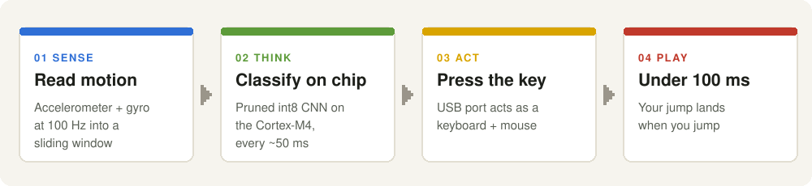
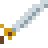
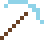
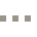

<p align="center">
  
</p>

<p align="center">
  
  
  
  
  <a href="https://github.com/oliBrowne/swing-to-mine/actions/workflows/ci.yml"></a>
</p>

**Swing to Mine** is a motion controller for Minecraft. You hold an STM32F4 Discovery board like a sword or pickaxe, and a small int8 neural network running **on the microcontroller itself** turns your moves into real key presses and mouse clicks. The board plugs in over USB and shows up as an ordinary keyboard and mouse, so nothing needs to be installed on the PC.

> Embedded AI final project, CU Boulder, Fall 2026. One-page pitch: [docs/pitch.pdf](docs/pitch.pdf)

## 📍 Where we are (Nov 15)

**Short version:** the gesture model works well and already runs on the board. The controller part (the board acting as a USB keyboard and mouse) isn't built yet, and nothing has been played in Minecraft so far.

**Done**

- **Data:** about 1,000 cues recorded with [`host/record.py`](host/README.md) from **four people** (P01, P02, P10, P11), plus one short session (P03) and 4.4 minutes of "just looking around" from P10. The capture firmware and recorder are tested on real hardware.
- **Model:** a small CNN (6,774 parameters) trained with leave-one-person-out testing: the model is always scored on a person it never saw.
- **On the board:** the int8 model runs on the STM32F407 in **3.4 ms** per window, using 117 KB of flash and 42 KB of RAM, with the same answers as the PC version ([`firmware/model_test`](firmware/model_test/README.md)).
- **Trigger rules:** the logic that turns model guesses into single clicks (confidence bar, 3 agreeing guesses, cooldown, hold for mining) is written in Python and C++ and checked to match on replayed recordings.

**How good is it** (all on the PC, on people the model never saw; details in [docs/results.md](docs/results.md))

| Test | Result |
|---|---|
| 1 s windows classified right | P01 99.4%, P02 99.9%, P10 96.1%, P11 96.8% |
| Whole recordings replayed like the board would, right gesture fired | 92.8 to 94.4% (3 training runs) |
| Accidental gestures while holding still between cues | 0.04 to 0.16 per minute |
| Accidental gestures while looking around (P10 only) | **0.2 to 1.4 per minute**, mostly "place" |

**Weak spots**

- **Looking around sets off "place".** Slow pointing movements look like a gentle forward jab. This is the biggest open problem, since look mode is most of the game. Next step: record look-around idle from everyone and train on it.
- **Slow sword swings** (P10 swings at about half the speed of the others) are only caught 75 to 81% of the time.
- **Hard wrist flicks** sometimes fire the opposite flick too, as the wrist bounces back.

**Not built yet**

- The board as a USB keyboard + mouse (HID)
- Gyro "air mouse" for looking, tilt to walk, jump
- The button and LED modes from [docs/controls.md](docs/controls.md) (look / move / inventory / crouch)
- Live test with the sensor: [`firmware/live_test`](firmware/live_test/README.md) is built (sensor → model → LEDs) but hasn't been run with an MPU-6050 attached, and the latest trigger rules aren't flashed yet

---

## ⛏️ How it works

<p align="center">
  
</p>

1. **Sense:** an MPU-6050 gyro + accelerometer is sampled at 100 Hz into a sliding window.
2. **Think:** a pruned, int8-quantized CNN (exported with ExecuTorch) classifies the latest window every ~50 ms on the Cortex-M4.
3. **Act:** the USB OTG port runs as a composite HID keyboard + mouse and sends the matching input.
4. **Play:** the target is under 100 ms from motion to input, so a jump lands when you jump.

## 🗡️ The moves

| | Move | Motion | Input sent |
|:-:|---|---|---|
|  | **Swing sword** | Side swipe | Left click |
|  | **Mine** | Keep chopping | Hold left click |
|  | **Place block** | Straight jab forward | Right click |
|  | **Swap item** | Quick flick left / right | Scroll wheel |
|  | **Idle** | Anything else | Nothing |
|  | **Jump** | Flick up, in move mode only (a simple rule, not the model) | `Space` |
|  | **Look / move** | Rotate the board to look; tilt to walk in move mode | Mouse movement / `WASD` |

No keyboard or mouse: the board does everything, including looking around (gyro "air mouse") and walking. See [docs/controls.md](docs/controls.md) for the button (move/look, inventory, crouch) and [docs/gesture-notes.md](docs/gesture-notes.md) for the gestures. Telling **sword** apart from **mining** is the interesting ML problem: Minecraft sees both as a left click, so the model has to recognize one slash vs. repeated chopping.

## 🗓️ Timeline

<p align="center">
  
</p>

Week-by-week plan with owners: [docs/roadmap.md](docs/roadmap.md) · Goals and success criteria: [docs/requirements.md](docs/requirements.md)

| Date | Milestone | Goal |
|---|---|---|
| ✅ Oct 25 | Kickoff | Team formed, repo set up |
| ✅ Nov 6 | Idea locked | Final gesture list and hardware |
| Nov 12 / 14 | Checkpoint presentation | Board works as a USB controller, first gesture data recorded |
| Nov 26 | Done by Thanksgiving | Int8 model running on the board, full controller working, demo video recorded |
| Dec 8 | Final presentation | Live demo: play Minecraft in front of the class |

## 🧱 Why it's an Embedded AI project

- **Our own dataset:** record every gesture from several people, like the Lab 2 accelerometer dataset.
- **Fit it on the chip:** prune and int8-quantize with ExecuTorch, like Lab 3, within 1 MB of flash and 192 KB of RAM.
- **New challenges:** classify a live stream instead of fixed clips, ignore random movement, and meet a real-time latency budget.
- **Real results:** measure accuracy vs. latency vs. model size, with and without the gyro.

## 🔌 Hardware

| Part | Notes |
|---|---|
| STM32F4 Discovery (STM32F407VG) | Cortex-M4 @ 168 MHz, 1 MB flash, 192 KB RAM, LIS3DSH accelerometer |
| MPU-6050 (GY-521) breakout | Gyro + accelerometer on I2C, about $5: [Amazon link](https://www.amazon.com/dp/B07MMZ37PT) |
| Micro-USB cable | To the USB OTG port: HID controller mode, plus USB serial mode for data collection |
| USB-to-UART adapter (for now) | Data collection until USB serial works; pinout in [docs/wiring.md](docs/wiring.md) |

Full parts list and compatibility notes: [docs/hardware.md](docs/hardware.md) · Step-by-step pinout: [docs/wiring.md](docs/wiring.md)

Control scheme, gesture list and data collection plan: [docs/gesture-notes.md](docs/gesture-notes.md)

Concept review from four perspectives (Minecraft, ML, UX, course): [docs/council-review.md](docs/council-review.md)

## 📁 Repo layout

```
firmware/   STM32 firmware: capture/ (data recording), model_test/ (model speed test), live_test/ (sensor -> model -> LEDs)
data/raw/   recorded gesture CSVs
training/   data loading, augmentation, training, compression, ExecuTorch export
host/       PC-side scripts (data capture over serial, live test tools)
docs/       pitch, plans, architecture, decisions, results
AGENTS.md   start here if you're an AI assistant (or new to the repo)
```

The design is in [docs/architecture.md](docs/architecture.md). Each folder has a README with its plan and status.

## 🚀 Getting started

Full play instructions will come once the controller firmware exists. What works now:

**1. Record gesture data** (tested on hardware)

1. Wire the MPU-6050 and a USB-UART adapter: [docs/wiring.md](docs/wiring.md)
   - Computer doesn't see the adapter or the board? Driver and COM port setup: [docs/setup-drivers.md](docs/setup-drivers.md)
2. Build and flash the capture firmware: [firmware/capture/README.md](firmware/capture/README.md)
3. Record (first time: set up the Python venv, see [firmware/capture/README.md](firmware/capture/README.md#python-virtual-environment)):
   ```bash
   pip install -r host/requirements.txt
   python host/record.py --port COM5 --check                              # is data coming in?
   python host/record.py --port COM5 --person P01 --session s01 --reps 10
   ```
   Cues come in random order in rounds of 20, with big colored GO boxes. More options: [host/README.md](host/README.md)

**2. Train and test the model** (on the PC)

```bash
pip install -r training/requirements.txt
python training/train.py               # tests on each person in turn, then trains on everyone
python training/evaluate_stream.py     # replays whole recordings through the trigger rules
```

More in [training/README.md](training/README.md).

**3. Run the model on the board:** export with `training/export.py`, then follow [firmware/model_test/README.md](firmware/model_test/README.md) (Linux or WSL, ExecuTorch 1.3.0).

## ✨ Stretch goals

- Walk-in-place detection instead of tilt-to-walk
- A second board for the other hand (shield, walking)

## 👥 Team

- **Oliver Browne**
- **Eli Garcia**

---

<sub>Not affiliated with Mojang or Microsoft. Minecraft is a trademark of Mojang Synergies AB. All pixel art in this repo is original.</sub>
