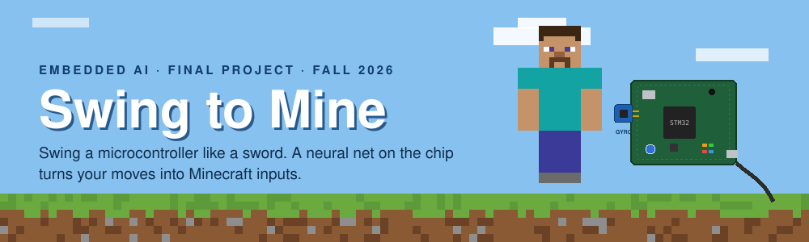
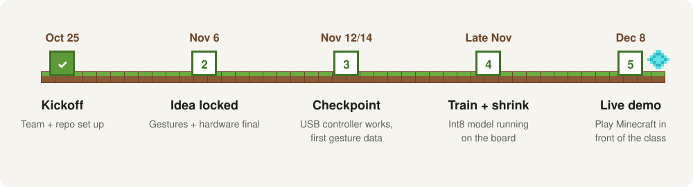

<p align="center">
  
</p>

<p align="center">
  
  
  
  
  <a href="https://github.com/oliBrowne/swing-to-mine/actions/workflows/ci.yml"></a>
</p>

**Swing to Mine** is a motion controller for Minecraft. You hold an STM32F4 Discovery board like a sword or pickaxe, and a small int8 neural network running **on the microcontroller itself** turns your moves into real key presses and mouse clicks. The board plugs in over USB and shows up as an ordinary keyboard and mouse, so nothing needs to be installed on the PC.

> Embedded AI final project, CU Boulder, Fall 2026. One-page pitch: [docs/pitch.pdf](docs/pitch.pdf)

## 📍 Where we are (Nov 15)

**Short version:** the gesture model works well and already runs on the board. The controller part (the board acting as a USB keyboard and mouse) isn't built yet, and nothing has been played in Minecraft so far.

**Done**

- **Data:** about 1,000 cues recorded with [`host/record.py`](host/README.md) from **four people** (P01, P02, P10, P11), plus one short session (P03) and 4.4 minutes of "just looking around" from P10. The capture firmware and recorder are tested on real hardware.
- **Model:** a small CNN (6,774 parameters) trained with leave-one-person-out testing: the model is always scored on a person it never saw.
- **On the board:** the int8 model runs on the STM32F407 in **3.4 ms** per window, using 117 KB of flash and 42 KB of RAM, with the same answers as the PC version ([`firmware/model_test`](firmware/model_test/README.md)).
- **Trigger rules:** the logic that turns model guesses into single clicks (confidence bar, 3 agreeing guesses, cooldown, hold for mining) is written in Python and C++ and checked to match on replayed recordings.

**How good is it** (all on the PC, on people the model never saw; details in [docs/results.md](docs/results.md#each-person-tested-on-their-own-nov-23-on-the-pc))

### 🧪 Tested on each person (Nov 23)

For each person, we trained a model on **everyone else** and then tested it on that person, so every number is for someone the model had never seen. Each test was repeated with 5 training runs and averaged. P03 has too little data to test and is only used for training.

| Person | Gestures tested | 1 s clips classified right | Weakest gesture | Gestures caught when replaying the whole recording | Accidental gestures per minute between cues |
|---|---|---|---|---|---|
| P01 | 259 | 99.4% | place (98%) | 100% | 0.09 |
| P02 | 218 | 99.5% | place (96%) | 97% | 0.04 |
| P05 | 50 | 97.2% | place (87%) | 89% | 0.56 |
| P06 | 120 | 97.7% | place (94%) | 95% | 0.00 |
| P07 | 46 | 94.9% | swap_left (86%) | 91% | 1.17 |
| P10 | 195 | 96.5% | sword (79%) | 91% | 0.32 |
| P11 | 146 | 97.2% | sword (91%) | 94% | 0.00 |
| **All** | **1,034** | **97.5%** (average of people) | **place 94%, sword 95%** | **95.4%** | **0.13** |

How to read it: "clips classified right" scores 1 s pieces cut around each gesture. "Gestures caught" is closer to real play: the whole recording is played through the model and the same trigger rules the board uses, and we count how many cued gestures fired the right action. P05 and P07 recorded only about 50 gestures and 2 minutes of pauses, so their numbers swing more (P07's accidental gestures are 1 to 4 events in total). Most of the new sessions (P01's newest, P05, P06, P07's first) haven't been checked for badly done cues yet, so a few of their "misses" may be recording mistakes rather than model mistakes. The "between cues" time is mostly holding still; looking around is harder (next table). Run it yourself with `python training/per_person.py`.

| Other tests | Result |
|---|---|
| Accidental gestures while looking around (P10 only, Nov 14) | **0.2 to 1.4 per minute**, mostly "place" |

**Weak spots**

- **Looking around sets off "place".** Slow pointing movements look like a gentle forward jab. This is the biggest open problem, since look mode is most of the game. Next step: record look-around idle from everyone and train on it.
- **Slow sword swings** (P10 swings at about half the speed of the others) are only caught about 70 to 80% of the time.
- **Hard wrist flicks** sometimes fire the opposite flick too, as the wrist bounces back.

**Not built yet**

- The board as a USB keyboard + mouse (HID)
- Gyro "air mouse" for looking, tilt to walk, jump
- The button and LED modes from [docs/controls.md](docs/controls.md) (look / move / inventory / crouch)
- Live test with the sensor: [`firmware/live_test`](firmware/live_test/README.md) is built (sensor → model → LEDs) but hasn't been run with an MPU-6050 attached, and the latest trigger rules aren't flashed yet

---

## ⛏️ How it works

<p align="center">
  
</p>

1. **Sense:** an MPU-6050 gyro + accelerometer is sampled at 100 Hz into a sliding window.
2. **Think:** a small int8-quantized CNN (exported with ExecuTorch) classifies the latest window every ~50 ms on the Cortex-M4.
3. **Act:** the USB OTG port runs as a composite HID keyboard + mouse and sends the matching input.
4. **Play:** the target is under 100 ms from motion to input, so a jump lands when you jump.

## 🗡️ The moves

| | Move | Motion | Input sent |
|:-:|---|---|---|
|  | **Swing sword** | Side swipe | Left click |
|  | **Mine** | Keep chopping | Hold left click |
|  | **Place block** | Straight jab forward | Right click |
|  | **Swap item** | Quick flick left / right | Scroll wheel |
|  | **Idle** | Anything else | Nothing |
|  | **Jump** | Flick up, in move mode only (a simple rule, not the model) | `Space` |
|  | **Look / move** | Rotate the board to look; tilt to walk in move mode | Mouse movement / `WASD` |

No keyboard or mouse: the board does everything, including looking around (gyro "air mouse") and walking. See [docs/controls.md](docs/controls.md) for the button (move/look, inventory, crouch) and [docs/gesture-notes.md](docs/gesture-notes.md) for the gestures. Telling **sword** apart from **mining** is the interesting ML problem: Minecraft sees both as a left click, so the model has to recognize one slash vs. repeated chopping.

## 🗓️ Timeline

<p align="center">
  
</p>

Week-by-week plan with owners: [docs/roadmap.md](docs/roadmap.md) · Goals and success criteria: [docs/requirements.md](docs/requirements.md)

| Date | Milestone | Goal |
|---|---|---|
| ✅ Oct 25 | Kickoff | Team formed, repo set up |
| ✅ Nov 6 | Idea locked | Final gesture list and hardware |
| Nov 12 / 14 | Checkpoint presentation | Board works as a USB controller, first gesture data recorded |
| Nov 26 | Done by Thanksgiving | Int8 model running on the board, full controller working, demo video recorded |
| Dec 8 | Final presentation | Live demo: play Minecraft in front of the class |

## 🧱 How the course labs show up in the project

| Lab | What it was | Where it is in Swing to Mine |
|---|---|---|
| **Lab 2: dataset** | Record and document an accelerometer gesture dataset | Our own dataset: ~1,000 cued gestures from 8 people, recorded with [`host/record.py`](host/README.md), with labels, bad-cue marking and person IDs only ([data/README.md](data/README.md)). Every accuracy number is on a person the model never saw. |
| **Lab 3: compress** | Channel-prune a CNN, fine-tune, int8 with ExecuTorch, check it in Renode | The gesture model runs int8 on the chip through ExecuTorch + CMSIS-NN. We pruned it to 75 / 50 / 35 / 25% of its channels three ways and compared with training the small model directly, in float and int8, and ran every size in Renode. |
| **Lab 4: accelerate** | Map a CNN onto hardware and find where the cycles go | Measured on the board: 152 ms → 3.4 ms per run (44×) from build flags, int8 and CMSIS-NN's DSP kernels. A simulator profile shows where the remaining time goes. |

### Shrinking and speeding up the model (Labs 3 and 4)

Full write-up, method and board test plan: **[docs/compression-and-speed.md](docs/compression-and-speed.md)**. All of it except the 3.41 ms was run without the board (PC + Renode simulator, Nov 23), on 7 people the model never saw, 3 training seeds.

| Model (channels per layer) | Params | Accuracy, float / int8 | Right gesture fired (replay) | Model file | Time per run |
|---|---|---|---|---|---|
| **Full (16/24/32), what the board runs** | 6,774 | 97.0% / 97.0% | 94.7% | 21.8 KB | **3.41 ms, measured** |
| 75%, trained small from scratch | 4,002 | 97.3% / 97.4% | 95.4% | 15.9 KB | ~2.5 ms, simulated |
| 50%, trained small from scratch | 1,950 | 95.9% / 95.7% | 93.3% | 11.3 KB | ~1.7 ms, simulated |
| 50%, pruned (batch-norm scale, Lab 3's best) + fine-tuned | 1,950 | 94.8% / 94.8% | 92.1% | 11.3 KB | ~1.7 ms, simulated |
| 25%, trained small from scratch | 618 | 94.2% / 94.2% | 91.4% | 8.3 KB | ~1.1 ms, simulated |
| 25%, pruned (batch-norm scale) + fine-tuned | 618 | 88.9% / 90.0% | 83.6% | 8.3 KB | ~1.1 ms, simulated |

What we found:

- **int8 is free** at every size (same answer as float on 98–100% of windows).
- **Pruning works but doesn't beat training the smaller model directly.** With equal training after the cut it catches up; with the usual short fine-tune the best pruned model is 0.5–4 points behind. Which channels get cut (batch-norm scale, weight size, or random) made little difference, unlike in Lab 3: this model is already tiny, so there's little dead weight to find.
- **A 40% smaller model (75%) loses nothing**; below half size, accuracy and the replay hit rate drop.
- **Time doesn't shrink as fast as size:** 89% fewer multiply-adds is only ~68% less work, because about half of each convolution is moving data into place, not multiplying (simulator profile).
- **Nothing here needs the smaller model:** the full model uses ~7% of the 50 ms between runs and ~11% of the flash, so the board keeps the full model for now. The simulated times are estimates calibrated on the one real board measurement; [the test plan](docs/compression-and-speed.md#5-tests-that-need-the-board-to-fill-in) has empty tables for the real speed, live accuracy, reaction time and power.

## 🔌 Hardware

| Part | Notes |
|---|---|
| STM32F4 Discovery (STM32F407VG) | Cortex-M4 @ 168 MHz, 1 MB flash, 192 KB RAM, LIS3DSH accelerometer |
| MPU-6050 (GY-521) breakout | Gyro + accelerometer on I2C, about $5: [Amazon link](https://www.amazon.com/dp/B07MMZ37PT) |
| Micro-USB cable | To the USB OTG port: HID controller mode, plus USB serial mode for data collection |
| USB-to-UART adapter (for now) | Data collection until USB serial works; pinout in [docs/wiring.md](docs/wiring.md) |

Full parts list and compatibility notes: [docs/hardware.md](docs/hardware.md) · Step-by-step pinout: [docs/wiring.md](docs/wiring.md)

Control scheme, gesture list and data collection plan: [docs/gesture-notes.md](docs/gesture-notes.md)

Concept review from four perspectives (Minecraft, ML, UX, course): [docs/council-review.md](docs/council-review.md)

## 📁 Repo layout

```
firmware/   STM32 firmware: capture/ (data recording), model_test/ (model speed test), live_test/ (sensor -> model -> LEDs)
data/raw/   recorded gesture CSVs
training/   data loading, augmentation, training, compression, ExecuTorch export
host/       PC-side scripts (data capture over serial, live test tools)
docs/       pitch, plans, architecture, decisions, results
AGENTS.md   start here if you're an AI assistant (or new to the repo)
```

The design is in [docs/architecture.md](docs/architecture.md). Each folder has a README with its plan and status.

## 🚀 Getting started

Full play instructions will come once the controller firmware exists. What works now:

**1. Record gesture data** (tested on hardware)

1. Wire the MPU-6050 and a USB-UART adapter: [docs/wiring.md](docs/wiring.md)
   - Computer doesn't see the adapter or the board? Driver and COM port setup: [docs/setup-drivers.md](docs/setup-drivers.md)
2. Build and flash the capture firmware: [firmware/capture/README.md](firmware/capture/README.md)
3. Record (first time: set up the Python venv, see [firmware/capture/README.md](firmware/capture/README.md#python-virtual-environment)):
   ```bash
   pip install -r host/requirements.txt
   python host/record.py --port COM5 --check                              # is data coming in?
   python host/record.py --port COM5 --person P01 --session s01 --reps 10
   ```
   Cues come in random order in rounds of 20, with big colored GO boxes. More options: [host/README.md](host/README.md)

**2. Train and test the model** (on the PC)

```bash
pip install -r training/requirements.txt
python training/train.py               # tests on each person in turn, then trains on everyone
python training/evaluate_stream.py     # replays whole recordings through the trigger rules
```

More in [training/README.md](training/README.md).

**3. Run the model on the board:** export with `training/export.py`, then follow [firmware/model_test/README.md](firmware/model_test/README.md) (Linux or WSL, ExecuTorch 1.3.0).

## ✨ Stretch goals

- Walk-in-place detection instead of tilt-to-walk
- A second board for the other hand (shield, walking)

## 👥 Team

- **Oliver Browne**
- **Eli Garcia**

---

<sub>Not affiliated with Mojang or Microsoft. Minecraft is a trademark of Mojang Synergies AB. All pixel art in this repo is original.</sub>
