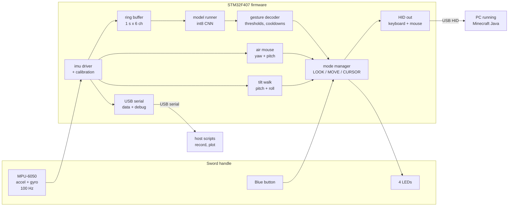
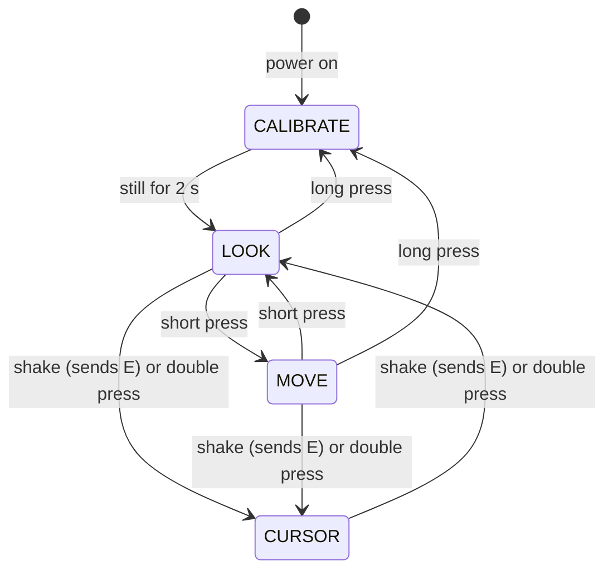

# Architecture

How Swing to Mine fits together. This is the **plan**, not a description of finished code: modules listed here may not exist yet. Check each folder's README for status.

## System overview



Two paths run side by side every sample:

- **ML path:** a sliding window goes through the int8 CNN every 50 ms, and the decoder turns class probabilities into game events (click, hold, jump, scroll, `E`).
- **Direct path:** the gyro and accelerometer drive looking (air mouse) and walking (tilt) with plain math, no ML.

The **mode manager** decides which outputs are live and merges everything into one HID report.

## Modes



| Mode | Air mouse | Tilt walk | Gestures | LED |
|---|---|---|---|---|
| CALIBRATE | off | off | off | all blinking |
| LOOK | yaw + pitch → camera | off | all | green |
| MOVE | yaw only → camera (steering) | pitch/roll → `WASD` | all | orange |
| CURSOR | yaw + pitch → cursor, low gain | off | punch = Shift+click, shake = exit | blue |

Rules in every mode:

- **Roll never moves the camera.** Roll is reserved for the swap-item twist.
- **Changing mode releases every held key and click.**
- **Rest pose** (board flat or face-down and still for >1 s) pauses all output; the red LED breathes.

## Gestures → game events

| Model class | Motion | Decoder output |
|---|---|---|
| `nothing` | anything else, including aiming, tilt-walking, resting | none |
| `slash` | horizontal swing | **strike** |
| `chop` | vertical chop | **strike** |
| `punch` | straight jab forward | right click (Shift+click in CURSOR) |
| `hop` | whole-body hop | `Space` |
| `swap_left` | first fast roll to the left | scroll up |
| `swap_right` | first fast roll to the right | scroll down |
| `shake` | quick back-and-forth shake | `E` + toggle CURSOR |

**Strike logic** (in the decoder, not the model): the first strike sends a left click; another strike within ~600 ms switches to **holding** left click; the hold releases after ~400 ms with no strikes. The camera stays frozen while holding, so the crosshair doesn't drift off the block. `slash` and `chop` stay separate classes only so we can report how well the model tells them apart.

## Timing budget

| Stage | Plan |
|---|---|
| Sampling | 100 Hz, MPU-6050 data-ready interrupt (or its FIFO) |
| Window | 100 samples = 1.0 s, 6 channels |
| Stride | 5 samples = 50 ms (20 inferences/s) |
| Inference | target < 5 ms on the Cortex-M4 |
| Decoder | needs 2–3 agreeing frames → adds 50–100 ms |
| USB | HID poll every 1 ms |
| Air mouse delay | output held back ~60 ms so a starting gesture can cancel it |
| **Target** | **≤ ~100 ms from the gesture's peak to the input** |

Measure with GPIO toggles on a logic analyzer/scope (or 240 fps video), and the DWT cycle counter for inference.

## Memory budget (STM32F407: 512 KB flash, 128 KB RAM + 64 KB CCM)

| Item | Estimate |
|---|---|
| Firmware + USB stack | ~60 KB flash |
| Inference runtime (ExecuTorch) | ~50–150 KB flash (unknown: measure early) |
| Model weights (int8) | < 50 KB flash |
| Window buffer | 100 × 6 × int16 = 1.2 KB RAM |
| Model activations | < 32 KB RAM |

DMA can't reach CCM, so keep USB and I2C DMA buffers in normal RAM.

## Interfaces (contracts between parts)

These are the agreements that let firmware, host and training be built in parallel. Change them only with the whole team.

### Sensor units

Raw MPU-6050 counts as `int16`, accel ±16 g (2048 counts/g), gyro ±2000 °/s (16.4 counts per °/s). Axes are the **sensor's** axes; the handle fixes the orientation (see [hardware.md](hardware.md)).

### USB serial stream (data mode)

The board streams one text line per sample at 100 Hz:

```
# swing-to-mine v1 rate_hz=100 accel_fs_g=16 gyro_fs_dps=2000
t_ms,ax,ay,az,gx,gy,gz
12034,-112,2051,48,-3,12,7
```

`t_ms` is board time in milliseconds. Debug/event lines start with `#` so parsers can skip them.

### Recorded data

```
data/raw/<person_id>/<session_id>.csv          # the stream above, as recorded
data/raw/<person_id>/<session_id>.labels.csv   # start_ms,end_ms,label
```

- `person_id` is anonymous: `P01`, `P02`, … (keep the name mapping out of the repo).
- `label` is one of the model classes above. Anything unlabeled counts as `nothing`.
- Sessions are **continuous**: the host script shows a cue, the person performs the gesture somewhere inside normal movement, and the label marks roughly where it happened. Training refines the label to the motion peak.

### Model input and output

- Input: `int8 [1, 6, 100]` (channels × time), scaled with fixed per-channel constants saved next to the model.
- Output: `int8/float [1, 8]` scores in the class order of the gestures table above.
- The class list lives in one place: `training/labels.py` (planned) and is mirrored in firmware by the export step.

## Toolchain (pin versions when first installed)

| Part | Tool |
|---|---|
| Firmware | STM32CubeIDE / CubeMX (HAL for clocks, I2C, GPIO, timers) |
| USB | TinyUSB (composite HID keyboard + mouse with report IDs, plus CDC serial). Fallback: pick HID or serial at boot |
| Inference | ExecuTorch (same flow as Lab 3). Fallback: TFLite Micro or hand-written int8 CNN with CMSIS-NN |
| Training | Python 3, PyTorch, NumPy, pandas |
| Host | Python 3, pyserial, matplotlib |

## Decisions log

| Date | Decision | Status |
|---|---|---|
| Oct 25 | No keyboard or mouse: the board does everything | ✅ decided |
| Oct 25 | MPU-6050 for both gyro and accel (onboard LIS3DSH unused) | ✅ decided |
| Oct 26 | Look/move switch is a **toggle** (short press) | ✅ decided |
| Oct 26 | Target Minecraft **Java Edition** | ✅ decided (confirm demo laptop has it) |
| Oct 26 | Sword + mine merged into one "strike" behavior in the decoder | 🟡 proposed default |
| Oct 26 | Shake = `E` + CURSOR mode; recipe book for crafting | 🟡 proposed default |
| Oct 26 | Jump = hop only, Auto-Jump on | 🟡 proposed default |
| Oct 26 | Fallback if behind: real keyboard for walking | 🟡 proposed default |

Background for these: [council-review.md](council-review.md).
