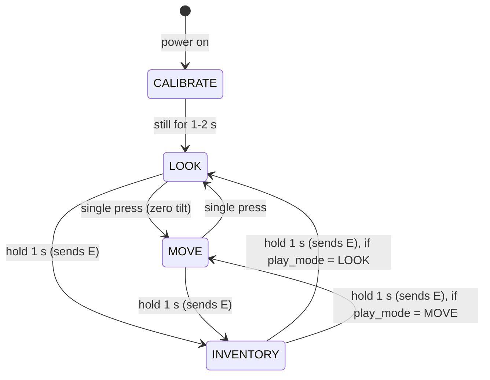

# Controls and board states

Every motion and button action, what it does in each mode, and what the firmware has to remember. This is a **spec**: none of it is built yet. [architecture.md](architecture.md#modes) and [gesture-notes.md](gesture-notes.md) follow it.

Everything here was decided by Oliver on Nov 12 unless marked 🟡 (suggested, not yet agreed). Numbers marked *tune* are starting values to adjust on the board.

## Quick reference

You hold the board **upright**, like a sword handle. There are three modes; the single press switches between the two play modes.

| Action | Move mode (orange) | Look mode, for placing blocks and fighting (green) | Inventory (blue) |
|---|---|---|---|
| **Tilt forward** ~15° | walk (`W`) | — | — |
| **Tilt forward** ~40°, held ~0.3 s | sprint (`W` + `Ctrl`) until you come back near upright | — | — |
| **Tilt back / sideways** | walk back / strafe (`S`, `A`, `D`) | — | — |
| **Turn left / right** (slowly) | steer the camera | move the camera | move the cursor (slower) |
| **Point up / down** (slowly) | — (forward tilt means walk) | move the camera | move the cursor (slower) |
| **Sword**: side swipe, board upright | — | one left click | — |
| **Mine**: pickaxe arc forward and down | — | hold left click (keep mining = keep holding) | — |
| **Place**: straight jab forward, no tilt | — | right click (place block, open chest) | — |
| **Hop** | — (Auto-Jump handles steps) | jump (`Space`) | — |
| **Swap** (quick twist left / right) | — | scroll one hotbar slot left / right | — |
| **Button: single press** | switch to look mode | switch to move mode | left click (pick up / drop) |
| **Button: double press** | crouch on/off (`Shift` tap) | crouch on/off (`Shift` tap) | — (just two clicks) |
| **Button: hold 1 s** | open inventory (`E`) | open inventory (`E`) | close inventory (`E`), back to the last play mode |
| **Button: hold 3 s** | resync (no key sent) | resync (no key sent) | resync (no key sent) |
| **Set it down** flat and still | pause all output | pause all output | pause all output |

"—" means the motion does nothing in that mode. Gestures (sword, mine, place, hop, swap) only work in look mode. In the inventory there are no right clicks or shift-clicks (no splitting stacks), on purpose to keep it simple.

*Reading of Oliver's words:* "movement mode" = move mode, "placing block mode" = look mode.

## Minecraft settings (check before every demo)

| Setting | Value | Why |
|---|---|---|
| Controls → Sneak | **Toggle** | the board only taps `Shift` |
| Controls → Sprint | **Hold** (default) | the board holds `Ctrl` |
| Auto-Jump | **On** | no hop gesture in move mode |

These are per computer, so they need setting on any new laptop.

## Pointing: look mode and inventory

Works like a Wii remote / air mouse. The gyro measures how fast you rotate the board, and that speed becomes mouse movement: turn slowly and the camera pans slowly, turn faster and it pans faster, stop and it stops. The board never needs to know where the screen is.

- **Dead zone** (*tune*, a few °/s): tiny rotations are ignored so a shaky hand doesn't drift the view.
- **Fast motion freezes the camera** (*tune*, roughly 200–300 °/s): a fast rotation is treated as a possible gesture, not looking. The camera freezes and picks up again where it was once the swing ends. The ~60 ms output delay in [architecture.md](architecture.md#timing-budget) lets a starting gesture cancel the bit of camera movement before it.
- **The cost:** you can't whip the camera around fast, because that looks like a gesture. Fine for Minecraft.
- **Left/right means turning around the vertical,** worked out from gravity, so it doesn't matter exactly how you hold the board.
- **Inventory** uses the same pointing with a lower gain (*tune*) so you can hit slots.
- **Move mode** only uses left/right (steering). Up/down is off there, because tilting forward means walk.

🟡 Watch out: holding the board upright, turning left/right is close to the same motion as the swap twist. The speed split should separate them (slow = look, quick flick = swap), but test it early.

## Move mode: walking and sprinting

**Zeroing on entry.** Every time you switch into move mode, the board saves its current angle as "neutral" and measures tilt from there. Hold it still for about 0.2 s after the switch; orange blinks once to confirm. You don't need to hold it perfectly straight, and slow drift is cleared on every switch.

| Tilt forward from neutral | Keys held | Game does |
|---|---|---|
| less than ~15° (*tune*) | nothing | stand still |
| ~15° or more | `W` | walk |
| ~40° or more (*tune*), held ~0.3 s | `W` + `Ctrl` | sprint |

- **Big gap between walk and sprint** so sprinting takes a clear lean and never happens by accident; the 0.3 s wait stops a quick wobble from starting one.
- **Sprint stays on until you're back under ~15°** (`W` lets go). Easing off a bit doesn't stop it, which is how Minecraft sprint works anyway.
- Tilt back and sideways for `S`, `A`, `D` the same way. Minecraft has no sprinting backwards or sideways.
- **No gestures in move mode.** Leaning to walk and swinging look alike to the sensor, so gestures are off to avoid false triggers. To fight or build, single press to look mode first.
- **Fallback if sprint-by-tilt feels bad:** a quick forward flick starts sprinting.

## The button

| Rule | Value |
|---|---|
| Debounce | ignore changes shorter than ~20 ms |
| Short press | released within ~400 ms |
| Double press | second press starts within **~300 ms** of the first release |
| Hold | still down after **1 s**: all four LEDs flash once |
| Resync hold | still down after **3 s**: all four LEDs spin |

- **In play,** a single press waits ~300 ms after release in case a second press comes. So switching move/look lags by about 0.3 s, which is fine for a mode switch.
- **In the inventory,** double press has no job, so the click goes out **as soon as you let go**, and only if the press was short. A 1 s hold to close never also clicks, and Minecraft never sees a long held left button (which would drag-split a stack).
- **Holds act when you let go,** not at the 1 s mark. Let go after the single flash = inventory; keep holding until the spin and let go = resync. A press released between 400 ms and 1 s does nothing, so you can back out.

## Crouch

A double press taps `Shift` (down, then up ~30 ms later) and Minecraft's **Sneak: Toggle** setting does the rest. `Shift` is never held, so inventory clicks can never turn into shift-clicks, and the board doesn't need to track crouch.

- If Sneak is left on **Hold** (the default), a double press only crouches for a split second.
- The board can't show crouch on an LED, because only the game knows.
- **To check by playing:** whether toggled crouch survives opening the inventory, dying or flying. If the game drops it, double press again.

## When the board and the game disagree

The board can't see the screen. It only *assumes* the inventory opened because it sent `E`. Ways it gets out of sync:

- **Opening a chest, crafting table or furnace.** A punch (right click) opens a menu, but the board still thinks it's in play. This will happen a lot.
- Dying or getting disconnected with the inventory open.
- Someone presses `E` or `Esc` on a real keyboard.

**Fix: hold 3 s to resync.** It flips the board between play and inventory **without sending any key**, releases everything, and blinks the new mode's LED 3 times. For a chest: punch it open, hold 3 s (board goes to inventory mode), move items, hold 1 s to close it as normal.

Passed on for now: "a 1 s hold within ~3 s of a punch means a chest opened" (smoother, but guesses wrong if you place a block then open the inventory), a triple press, or skipping chests and crafting tables.

## LEDs

The four LEDs sit in a ring: orange (LD3, top), green (LD4, left), red (LD5, right), blue (LD6, bottom).

| LED | Meaning |
|---|---|
| **Orange** steady | move mode |
| **Green** steady | look mode |
| **Blue** steady | inventory |
| **Red** short blink (~100 ms) | the model recognised a gesture (handy for testing and the demo video) |
| All four spin | calibrating at power-on: keep still |
| All four flash once, while holding | 1 s reached: let go to open/close the inventory |
| All four spin, while holding | 3 s reached: let go to resync |
| Mode LED blinks 3 times | resync done |
| Mode LED blinks twice | crouch tap sent |
| Orange blinks once | move mode zeroed |
| Mode LED breathes | rest pose: output paused |
| Red fast blink, nothing else | something's wrong (e.g. sensor not answering on I2C) |

## State the firmware tracks

| State | Values | Why |
|---|---|---|
| `mode` | `CALIBRATE`, `LOOK`, `MOVE`, `INVENTORY` | what the gyro, tilt and gestures do |
| `play_mode` | `LOOK` or `MOVE` | where to go back to when the inventory closes |
| `neutral` | angle saved on entering move mode | tilt is measured from here |
| `sprinting` | on / off | keep `Ctrl` until tilt drops under the walk angle |
| button timer | idle, down, waiting-for-second-press | single vs double vs hold |

Crouch isn't tracked: the game remembers it.

A 3 s hold jumps between play and `INVENTORY` the same way but sends nothing. Double press doesn't change the mode.

Other rules:

- **Changing mode releases held inputs** (walking keys, `Ctrl`, a held left click from mining).
- **Rest pose** (set down flat and still for >1 s) pauses all output.
- **Calibration:** the full gyro calibration (about 1–2 s still, averages the drift) runs at power-on; the black reset button redoes it.
- **USB unplug or reset:** the board starts over (`CALIBRATE`, then `LOOK`). Crouch is unaffected because the game holds it.

## Open questions

1. **Jumping while walking:** gestures are off in move mode, so the only jumping there is Auto-Jump (steps up single blocks). Fine for walking around, but you can't jump gaps or two-block climbs without switching to look mode. Allow the hop gesture in move mode too, or leave it?
2. 🟡 **Recalibrating later:** also recalibrate automatically whenever the board rests flat for 2 s? (Zeroing on move-mode entry may make this unnecessary.)
3. **Shake gesture:** it was going to open the inventory; the button does that now, so shake does nothing. Drop the `shake` class from the model (simpler, fewer false triggers)?
