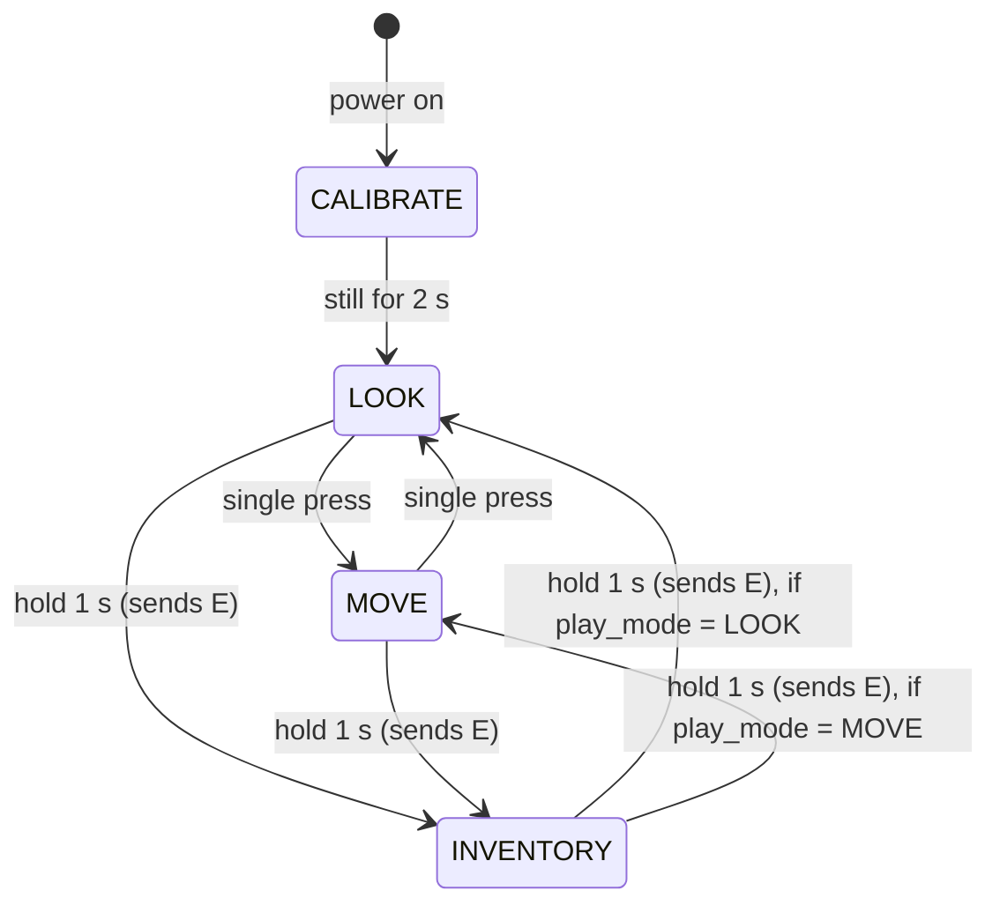

# Button controls and board states

How the blue user button works, and what the firmware has to remember. This is a **spec**: none of it is built yet. It replaces the button table that used to be in [gesture-notes.md](gesture-notes.md), and the modes in [architecture.md](architecture.md#modes) follow it.

Decided by Oliver on Nov 12 unless marked 🟡 (suggested, not yet agreed).

## The button

| Press | In play (look or move mode) | In inventory |
|---|---|---|
| **Single press** | Switch between **move mode** and **look mode** | **Left click** (click to pick up, click again to drop) |
| **Double press** | Toggle **crouch** (taps `Shift`; Minecraft's Sneak is set to **Toggle**) | Nothing extra (it's just two clicks) |
| **Hold 1 s** | **Open the inventory** (sends `E`) | **Close the inventory** (sends `E`) |
| **Hold 3 s** | Resync: switch the board's state without sending anything (see [When the board and the game disagree](#when-the-board-and-the-game-disagree)) | same |

The two play modes are the ones already in the docs:

- **Move mode** (orange LED): tilt the board to walk (`WASD`); turning left/right still steers.
- **Look mode** (green LED): the gyro aims the camera like a pointer. This is the mode for **placing blocks** and fighting, since you need to aim precisely. Gestures work in both modes.

*Reading of Oliver's words:* "movement mode" = move mode and "placing block mode" = look mode. If that's wrong, only the names change, not the button logic.

There are no right clicks or shift-clicks in the inventory, so no splitting stacks or quick-moving items. That's on purpose to keep it simple.

## Move mode: walking and sprinting

Decided Nov 12. The angles are **starting values to tune on the board**.

| Tilt forward | Keys held | Game does |
|---|---|---|
| less than ~15° | nothing | stand still |
| ~15° or more | `W` | walk |
| ~40° or more, held ~0.3 s | `W` + `Ctrl` | sprint |

- **Big gap between walk and sprint** (15° vs 40°), so sprinting takes a clear lean and never happens by accident.
- **The 0.3 s wait** stops a gesture swing from starting a sprint.
- **Sprint stays on until the board is back under ~15°** (when `W` lets go). Easing off a bit, or wobbling, doesn't stop it. That's how Minecraft sprint works anyway: once you're sprinting, it keeps going as long as you hold `W`.
- Leave Minecraft's **Sprint** setting on **Hold** (the default).
- Tilting back and sideways (`S`, `A`, `D`) works the same as walking; there's no sprint backwards or sideways in Minecraft.
- Sprint only exists in move mode. Look mode never walks.
- **Fallback if it feels bad in testing:** a quick forward flick starts sprinting instead of the steep tilt.

## Timing

| Rule | Value |
|---|---|
| Debounce | ignore changes shorter than ~20 ms |
| Short press | released within ~400 ms |
| Double press | second press starts within **~300 ms** of the first release |
| Hold | still down after **1 s** (LED flashes so you know to let go) |
| Resync hold | still down after 3 s |

How each press is recognized:

- **In play,** a single press can't act straight away, because it might be the first half of a double press. The board waits ~300 ms after release; if no second press comes, it's a single press. So switching move/look lags by about 0.3 s. That's fine for a mode switch.
- **In the inventory,** double press has no job, so the click goes out **as soon as you let go**. Clicks feel instant.
- **Holds act when you let go,** not at the 1 s mark. At 1 s all four LEDs flash once ("let go now = inventory"); keep holding and at 3 s they spin in a circle ("let go now = resync"). See [LEDs](#leds). A press released between 400 ms and 1 s does nothing, so you can back out.
- In the inventory the click is sent on release only if the press was short. That way a 1 s hold to close never also clicks, and Minecraft never sees a long held left button (which would drag-split a stack across slots).

## State the firmware tracks

| State | Values | Why |
|---|---|---|
| `mode` | `CALIBRATE`, `LOOK`, `MOVE`, `INVENTORY` | what the gyro, tilt and gestures do |
| `play_mode` | `LOOK` or `MOVE` | which play mode to go back to when the inventory closes |
| button timer | idle, down, waiting-for-second-press | single vs double vs hold |

What each mode does:

| Mode | Gyro | Tilt walk | Gestures | Button single press | LED |
|---|---|---|---|---|---|
| `CALIBRATE` | off | off | off | ignored | spinning |
| `MOVE` | yaw steers camera | `WASD` | on | → `LOOK` | orange |
| `LOOK` | aims camera | off | on | → `MOVE` | green |
| `INVENTORY` | moves the cursor (lower gain) | off | **paused** | left click | blue |

Crouch isn't tracked by the board: Minecraft remembers it (see [Crouch](#crouch-uses-minecrafts-toggle-setting)).

Double press (crouch) doesn't change the mode, so it isn't drawn.

## Edge cases

### Crouch uses Minecraft's toggle setting

Set **Options → Controls → Sneak: Toggle** on every computer we play on (it's a per-computer setting). Then a double press just taps `Shift` (down, then up ~30 ms later) and Minecraft itself switches crouch on or off. Oliver's call on Nov 12, instead of the board holding `Shift` down.

Why it's simpler:

- `Shift` is never held, so clicks in the inventory can never turn into shift-clicks (which would move whole stacks).
- The board doesn't have to release and re-press `Shift` around the inventory, during rest pose, or on mode changes.
- The board doesn't need a crouch flag.

Catches:

- **If the setting is left on Hold** (the default), a double press only crouches for a split second. Easy to forget on a new laptop, so check it before every demo.
- The board can't show crouch on an LED, because only the game knows whether you're crouching.
- **To check by playing:** whether toggled crouch stays on after opening the inventory, dying or flying. We haven't tested this; if the game drops crouch, you just double press again.

**Changing mode releases held inputs** (walking keys, a held left click from mining).

**USB unplug or reset:** the board starts over (`CALIBRATE`, then `LOOK`). Crouch is unaffected because the game holds it.

## LEDs

The Discovery board has four LEDs in a ring around the middle: orange (LD3, top), green (LD4, left), red (LD5, right), blue (LD6, bottom). The plan is to use them like this:

| LED | Meaning |
|---|---|
| **Green** steady | look mode (placing blocks) |
| **Orange** steady | move mode (walking) |
| **Blue** steady | inventory mode |
| **Red** short blink (~100 ms) | the model recognised a gesture (handy for testing and for the demo video) |

Feedback patterns, using all four:

| Pattern | Meaning |
|---|---|
| All four spin around the ring | calibrating (power-on): keep the board still |
| All four flash once while holding | 1 s reached: let go to open/close the inventory |
| All four spin while holding | 3 s reached: let go to resync |
| New mode's LED blinks 3 times | resync done |
| Current mode's LED blinks twice | double press: crouch tap sent |
| Current mode's LED breathes (fades in and out) | rest pose: output paused |
| Red fast blink, nothing else | something's wrong (e.g. sensor not answering on I2C) |

The board doesn't know whether you're crouching (the game does), so no LED shows crouch.

## When the board and the game disagree

The board can't see the screen. It only *assumes* the inventory opened because it sent `E`. Ways it can get out of sync:

- **Opening a chest, crafting table or furnace.** A punch (right click) on one opens a menu, but the board still thinks it's in play. This will happen a lot.
- Dying or getting disconnected with the inventory open (the game closes it, the board doesn't know).
- Someone presses `E` or `Esc` on a real keyboard (only if we use the keyboard fallback for walking).

**Fix: hold 3 s to resync** (decided Nov 12). It flips the board between play and inventory **without sending `E`**, releases everything, and blinks the new mode's LED 3 times. So when the LED colour and the screen disagree, hold 3 s and they match again. For a chest: punch it to open it, hold 3 s (board goes to inventory mode), move items, then hold 1 s to close it as normal.

Ideas we passed on for now (Nov 12): "if you punched in the last ~3 s, a 1 s hold means a chest opened" (smoother, but guesses wrong if you place a block then open the inventory), a triple press, or skipping chests and crafting tables.

## Open questions for Oliver

1. **Recalibrating:** this used to be the long press, which is now the inventory. 🟡 Suggestion: recalibrate the gyro automatically whenever the board sits in rest pose for 2 s, plus at power-on (and the black reset button reboots it). No button needed.
2. **Shake gesture:** it was going to open the inventory. The button does that now, so 🟡 shake no longer sends `E`. Should we drop the `shake` class from the model (simpler, fewer false triggers) or keep it for something else?
