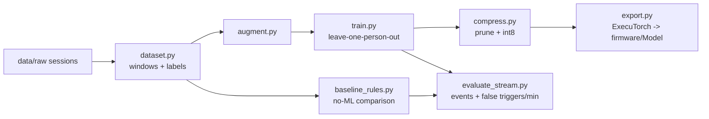

# training/

Everything from recorded sessions to the model file the firmware runs.

**Status:** only `labels.py` exists (the single source of truth for classes).

## Pipeline

## Planned files

| File | What it does |
|---|---|
| `labels.py` | Class list and order. **Change only with the whole team.** |
| `dataset.py` | Loads sessions, snaps labels to motion peaks, cuts 1 s windows (stride 50 ms), splits by person |
| `augment.py` | Time shift, ±15° rotation, amplitude/time warp, noise; mirror with left/right label swap |
| `model.py` | Small 1D CNN on `[6, 100]`; a few width options for the size sweep |
| `train.py` | Leave-one-person-out training; reports mean ± spread |
| `baseline_rules.py` | Threshold / peak rules for each gesture: the "why ML?" comparison |
| `compress.py` | Pruning (Lab 3 style) and int8 quantization |
| `export.py` | ExecuTorch export + per-channel scaling constants into `firmware/.../Model/` |
| `evaluate_stream.py` | Replays whole sessions like the board would: event precision/recall, false triggers per minute, latency in samples |

## Experiments to report (in `docs/results.md`)

- [ ] CNN vs rule baseline: accuracy and false triggers/min on unseen people
- [ ] Model size sweep: accuracy vs flash/RAM vs inference time
- [ ] float32 vs int8, pruned vs not
- [ ] Accel only vs accel + gyro
- [ ] False triggers/min vs amount of "nothing" data
- [ ] Slash vs chop: can the model tell them apart?

## Setup

Python 3, PyTorch, NumPy, pandas, and the ExecuTorch version from Lab 3. Pin versions in `requirements.txt` when the first script lands.
