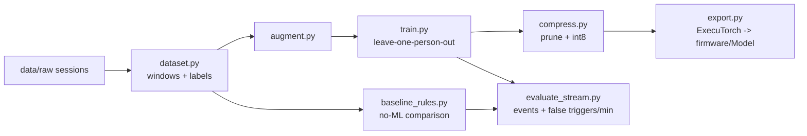

# training/

Everything from recorded sessions to the model file the firmware runs.

**Status (Nov 13):** `labels.py`, `dataset.py`, `model.py` and `train.py` exist. The rest of the table below is still planned.

## Try it

```
pip install -r training/requirements.txt
python training/dataset.py      # how many windows per person and gesture
python training/train.py        # test on each person in turn, then save training/out/gesture_small.pt
```

First result (Nov 13, 2 people, 5426 windows, `small` model = 6,774 parameters, float, on the PC): tested on a person the model never saw, 95% of windows right (nothing 97, sword 91, mine 94, place 96, swap_left 95, swap_right 92). With `--with-jump`: jump 92, but place and jump get mixed up for some jumps. This is per 1 s window on cut-out gestures, not yet false triggers per minute on a live stream, and not yet on the board.

## Pipeline



## Planned files

| File | What it does |
|---|---|
| `labels.py` | Class list and order. **Change only with the whole team.** |
| `dataset.py` | Loads sessions, snaps labels to motion peaks, cuts 1 s windows (stride 50 ms), splits by person |
| `augment.py` | Time shift, ±15° rotation, amplitude/time warp, noise; mirror with left/right label swap |
| `model.py` | Small 1D CNN on `[6, 100]`; a few width options for the size sweep |
| `train.py` | Leave-one-person-out training; reports mean ± spread |
| `baseline_rules.py` | Threshold / peak rules for each gesture: the "why ML?" comparison |
| `compress.py` | Pruning (Lab 3 style) and int8 quantization |
| `export.py` | ExecuTorch export + per-channel scaling constants into `firmware/.../Model/` |
| `evaluate_stream.py` | Replays whole sessions like the board would: event precision/recall, false triggers per minute, latency in samples |

## Experiments to report (in `docs/results.md`)

- [ ] CNN vs rule baseline: accuracy and false triggers/min on unseen people
- [ ] Model size sweep: accuracy vs flash/RAM vs inference time
- [ ] float32 vs int8, pruned vs not
- [ ] Accel only vs accel + gyro
- [ ] False triggers/min vs amount of "nothing" data
- [ ] Sword vs mine: can the model tell one side swipe from a pickaxe arc?

## Setup

Python 3, PyTorch, NumPy, pandas (`training/requirements.txt`). Export will also need the ExecuTorch version from Lab 3.
