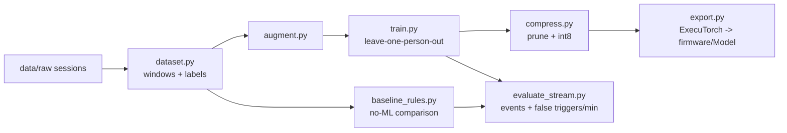

# training/

Everything from recorded sessions to the model file the firmware runs.

**Status (Nov 13):** `labels.py`, `dataset.py`, `model.py`, `train.py` and `export.py` exist. The rest of the table below is still planned.

## Try it

```
pip install -r training/requirements.txt
python training/dataset.py      # how many windows per person and gesture
python training/train.py        # test on each person in turn, then save training/out/gesture_small.pt
python training/export.py       # int8 .pte for the board (needs the ExecuTorch env, see firmware/model_test)
```

On the board (Nov 13): the int8 export runs in **3.41 ms** per window at 168 MHz with the same top gesture as float, and int8 accuracy on unseen people equals float. Details in [docs/results.md](../docs/results.md).

Architecture (Nov 13 sweep, 3 seeds, ±0.5 points spread between seeds): **max pooling over time** beat the original average pooling (96.3% vs 95.5% on unseen people) at no extra cost, so it's the default now (`--pool max|avg|avgmax`). Bigger, deeper, residual, dilated and depthwise variants were all within noise or worse, so model size isn't the bottleneck: more people's data is. Current model (max pooling, seed 0): P01 97.0%, P02 94.7%; int8 within 0.1 point of float. Old checkpoints (no `pool` entry) still load as average pooling.

First result (Nov 13, 2 people, 5426 windows, `small` model = 6,774 parameters, float, on the PC): tested on a person the model never saw, 95% of windows right (nothing 97, sword 91, mine 94, place 96, swap_left 95, swap_right 92). With `--with-jump`: jump 92, but place and jump get mixed up for some jumps. This is per 1 s window on cut-out gestures, not yet false triggers per minute on a live stream, and not yet on the board.

## Pipeline



## Planned files

| File | What it does |
|---|---|
| `labels.py` | Class list and order. **Change only with the whole team.** |
| `dataset.py` | Loads sessions, snaps labels to motion peaks, cuts 1 s windows (stride 50 ms), splits by person |
| `augment.py` | Time shift, ±15° rotation, amplitude/time warp, noise; mirror with left/right label swap |
| `model.py` | Small 1D CNN on `[6, 100]`; a few width options for the size sweep |
| `train.py` | Leave-one-person-out training; reports mean ± spread |
| `baseline_rules.py` | Threshold / peak rules for each gesture: the "why ML?" comparison |
| `compress.py` | Pruning (Lab 3 style) and int8 quantization |
| `export.py` | ✅ ExecuTorch export: int8 for CMSIS-NN (default) or `--float`, plus test windows for `firmware/model_test`. Still to do: write into the main firmware's `Model/` with the scaling constants |
| `evaluate_stream.py` | **Exists.** Replays whole sessions like the board would (model every 50 ms + the firmware decoder): hits, misses, double fires, wrong gestures, false triggers per minute |

## Experiments to report (in `docs/results.md`)

- [ ] CNN vs rule baseline: accuracy and false triggers/min on unseen people
- [ ] Model size sweep: accuracy vs flash/RAM vs inference time (accuracy part done Nov 13, see results.md; board time only measured for `small`)
- [ ] float32 vs int8, pruned vs not (int8 vs float done: same accuracy, 3.4 ms vs 64 ms; pruning not yet)
- [ ] Accel only vs accel + gyro
- [ ] False triggers/min vs amount of "nothing" data
- [ ] Sword vs mine: can the model tell one side swipe from a pickaxe arc?

## Setup

Python 3, PyTorch, NumPy, pandas (`training/requirements.txt`). `export.py` also needs the ExecuTorch 1.3.0 env from Lab 3 (`~/executorch/et-env`).
